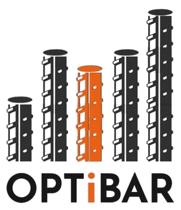

# OPTiBAR

[](./LICENSE)


<p align="center">
  
</p>

<p align="center">
  🚧 **UNDER CONSTRUCTION** 🚧  
  _This project is actively being developed—APIs and features may change._
</p>


[📚 Read the full documentation](https://optibar.readthedocs.io/)  

OPTiBAR turns the design results of a concrete mat foundation in **CSI SAFE** into a rebar detailing map. It places the typical, additional and shear rebars, then reduces the number of different bar lengths with an optimization that keeps the extra steel as small as possible, so the drawing stays practical to cut, place and check.

## ✅ What It Does

- **Reads the SAFE model and design results** from the Access database (`.accdb` / `.mdb`) that SAFE exports.
- **Computes the rebar detailing** of every design strip: theoretical lengths from the required steel, required lengths from the code (development length and effective depth), and practical lengths rounded and reduced to the number of length types you allow.
- **Analyses scenarios**: compares the rebar mass for a range of allowed length types, so you can pick a good trade-off.
- **Produces drawings and reports**: a DXF detailing map (opens in AutoCAD, AutoCAD LT, BricsCAD and free viewers), a PDF sketch, and the results as JSON with a readable summary.
- **Works offline** through a desktop app, or from Python.

## ❌ What It Doesn't Do

- Does not perform **structural analysis** or modeling; it only processes the design results of SAFE.
- Does not handle **3D visualization** of rebar placement; only 2D detailing maps.

## 🛠️ Installation

### Prerequisites

- Windows (reading SAFE's Access files needs a Windows ODBC driver)
- Python 3.13 or higher, or [uv](https://docs.astral.sh/uv/)
- The **Microsoft Access ODBC driver**, from the [Microsoft Access Database Engine 2016 Redistributable](https://www.microsoft.com/en-us/download/details.aspx?id=54920). Install the 64-bit version for 64-bit Python. OPTiBAR tells you when it is missing.

Clone the repository and run the app with uv:

```bash
git clone https://github.com/OPTiBAR/OPTiBAR.git
cd OPTiBAR
uv run main.py
```

Or install it with pip and start it with the `optibar` command:

```bash
pip install git+https://github.com/OPTiBAR/OPTiBAR
optibar
```

## How to use

### 🖱️ Desktop app

1. In SAFE, export the model to an Access database, including the **Model Definition** and **Design Results** tables.
2. **1. Input File**: browse to the `.accdb` / `.mdb` file and press **Load**.
3. **2. Calculation**: choose **Computation** for one detailing, or **Analysis** to compare a range of length types. Adjust diameters, spacing, cover and the number of length types, and optionally the special lengths and per-strip exceptions under **Advanced**. Press **Calculate**.
4. **3. Results**: read the mass summary and warnings, then save the results (JSON and summary), the **DXF Drawing** or the **PDF Drawing**. For an analysis, **Diagram** plots the mass against the number of length types.

See the [quick start](https://optibar.readthedocs.io/en/latest/tutorial/quickstart.html) for details.

### 🐍 Python

```python
from optibar.core.parser.parse import V16Parser
from optibar.core.run import run_calculation
from optibar.core.sketch.dxf import DxfDrawing

parser = V16Parser("foundation.accdb")
foundation = parser.get_foundation()
parser.close()

config = {
    "diameter": {"typical": 18, "additional": 25, "thermal": 12, "shear": 14},  # mm
    "typical_arrangement": {"method": "INTERVAL", "value": 0.2},               # m
    "side_cover": 0.05,                                                          # m
    "elimination": {"additional": 0.2, "shear": 2.0},                           # m
    "type_number": {"total": 20, "stack": 2, "shear": 4},
}
output = run_calculation(foundation, config)
DxfDrawing(output["data"]).save("foundation.dxf")
```

There is no command line interface yet.

## 👥 Contributors

- [**Sina Hajikazemi**](https://sinahkazemi.github.io)
- [**Amir Salar**](https://github.com/AmirSLRM)

## 🤝 How to Contribute

We welcome contributions! To get started:

1. **Select an issue** labeled **"easy to start"** from the [issues list](https://github.com/OPTiBAR/OPTiBAR/issues).
2. **Fork** the repository and **clone** it to your machine.
3. Create a new branch, make your changes, and **commit** them.
4. **Push** your branch and open a **pull request**.

Run the tests with `uv run pytest src/optibar/gui/tests src/optibar/core/tests/parser src/optibar/core/tests/sketch`.

## 📄 License

This project is licensed under the **GNU General Public License v3.0** – see the [LICENSE](LICENSE) file for details.
