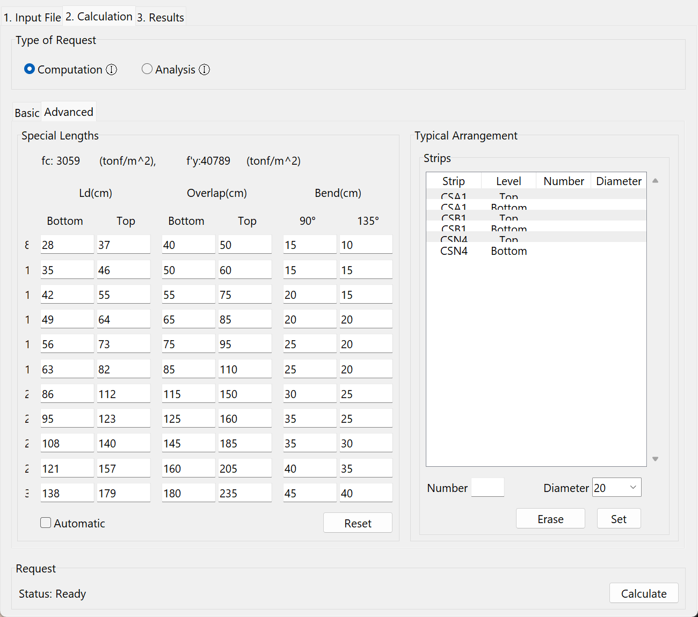

Adjust the detailing of a project
=================================

The **Advanced** tab of **2. Calculation** changes the detailing beyond the basic settings.
Both changes below are optional.

## Change the development, overlap and bend lengths

OPTiBAR calculates these lengths from the concrete and steel of the SAFE model when the file is loaded; see [Special lengths](../reference/detailing-rules.md#special-lengths).
Change them when the conditions of the foundation call for it, for example closely spaced bars or shear rebars.

1. In **Advanced > Special Lengths**, find the row of the bar diameter.
2. Edit the value, in cm.
   With **Automatic** checked, edit only the bottom development length (Ld); the top Ld and the overlaps follow from it.
3. Press **Calculate** again.

To go back to the calculated values, press **Reset**.

## Set the typical rebars of a strip

By default, every strip gets typical rebars at the interval of the **Basic** tab.
To give one strip a different number of bars or a different diameter:

1. In **Advanced > Typical Arrangement**, select the strip and the level (top or bottom).
2. Enter the **Number** of bars and the **Diameter**.
3. Press **Set**.

For example, a strip 1.2 m wide gets 6 typical bars with an interval of 20 cm; set its top level to 8 to place 8 bars instead.
To remove the override, select the strip and level and press **Erase**.

OPTiBAR places the bars you set even when they are less than the minimum steel, and reports a warning, see [Typical rebars](../reference/detailing-rules.md#typical-rebars).
