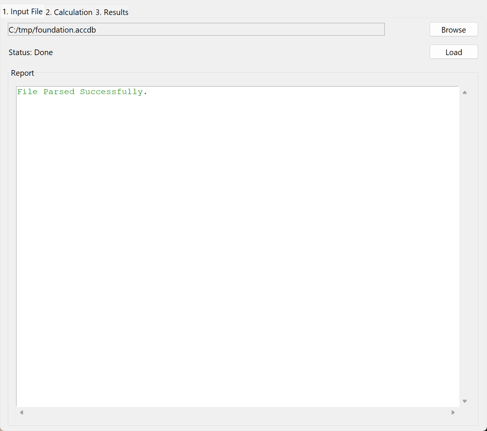
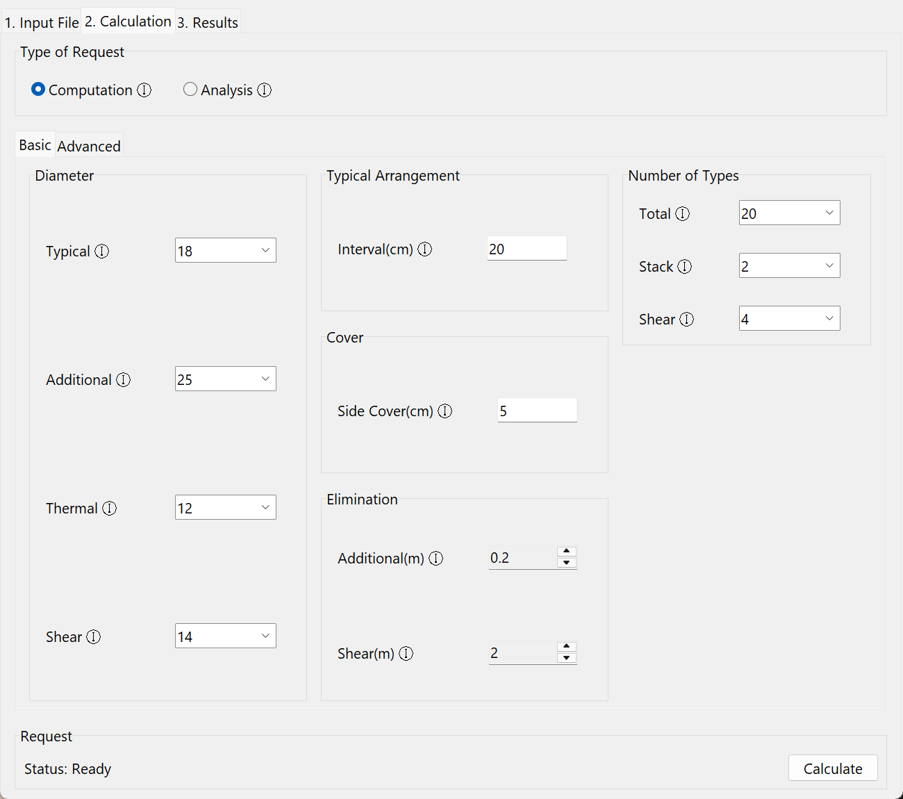
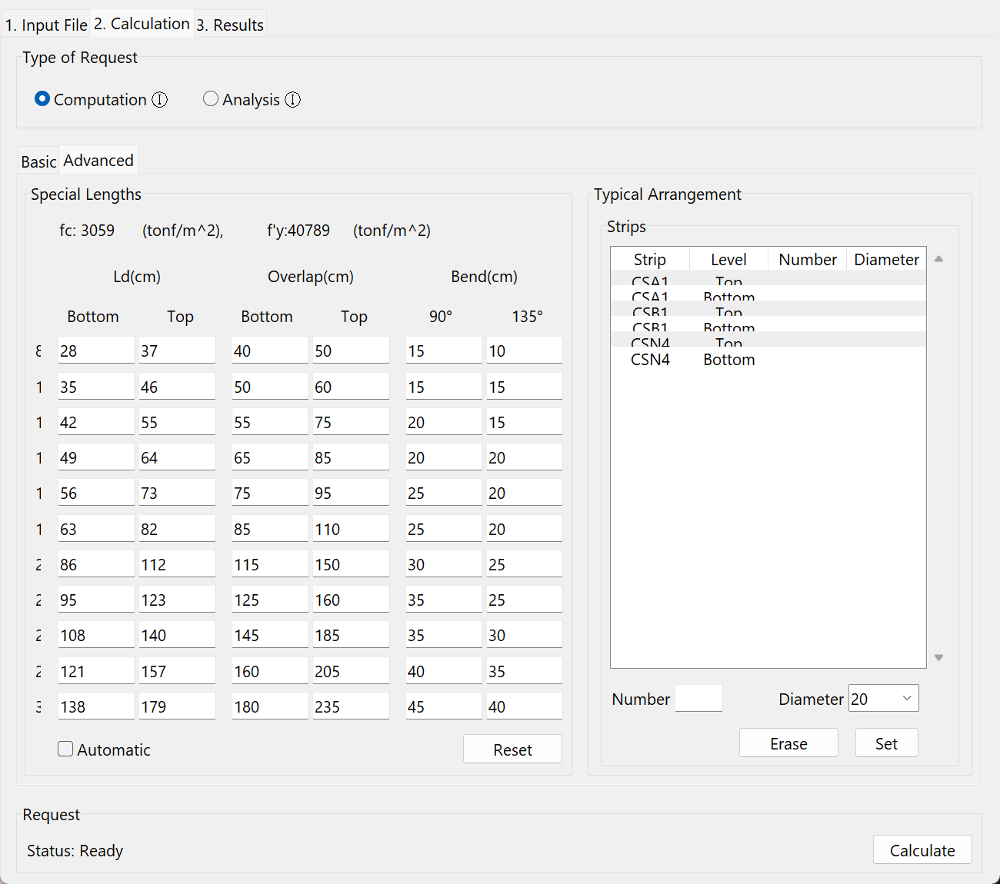
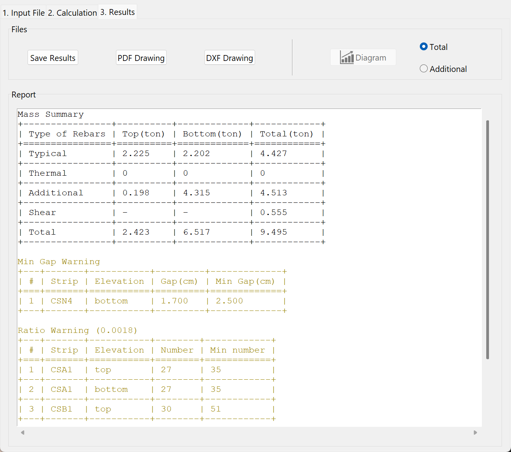

Quick Start
============

This page walks through one project, from the SAFE model to the detailing map.

## 1. Export the model from SAFE

Run the design in SAFE, then export the model to a Microsoft Access database (`.accdb` or `.mdb`).
Select both table groups in the export dialog:

- **Model Definition**: grids, strips, slab properties, areas, columns and materials.
- **Design Results**: the flexural and shear design of the strips.

OPTiBAR reports which group is missing if the file doesn't have the tables it needs.

## 2. Load the file

In **1. Input File**, press **Browse**, choose the exported file and press **Load**.
The **Report** box confirms the file was parsed, and warns when the model uses more than one concrete or steel material.



## 3. Set up the calculation

In **2. Calculation**, choose the **Type of Request**:

- **Computation** details the foundation once, with the settings below.
- **Analysis** repeats the detailing for a range of length types and compares the rebar mass of each, see [Analysis](#analysis).



The **Basic** tab holds the main settings. Hover the ⓘ next to a setting for a short description.

| Setting | Meaning |
| --- | --- |
| Diameter | Bar diameter in mm of the typical, additional (reinforcing), thermal and shear rebars. |
| Typical Arrangement, Interval | Spacing of the typical rebars in cm. |
| Cover, Side Cover | Minimum distance of the longitudinal rebars to the side of the foundation, in cm. |
| Elimination, Additional | Additional rebars with a theoretical length shorter than this, in m, are left out. |
| Elimination, Shear | Parts of a strip needing shear rebars that are shorter than this, in m, get none. |
| Number of Types, Total | The maximum number of different additional rebar lengths in the whole foundation. |
| Number of Types, Stack | The maximum number of different additional rebar lengths in one stack of bars. |
| Number of Types, Shear | The maximum number of different shear rebar arrangements in the foundation. |

Fewer length types make the drawing simpler to cut, place and check, at the cost of some extra steel.



The **Advanced** tab is optional:

- **Special Lengths** are the development length (Ld), overlap length and bend lengths per diameter, in cm.
  They are calculated from the project's concrete and steel when the file is loaded; **Reset** restores those values.
  With **Automatic** checked, the top Ld and the overlaps follow from the bottom Ld.
- **Typical Arrangement** overrides the typical rebars of single strips: select a strip and level, enter a number of bars and a diameter, and press **Set**. **Erase** removes the override.

Press **Calculate**. The button turns into **Stop** while the calculation runs, which you can press to cancel it.

## 4. Results

When the calculation finishes, **3. Results** shows the rebar mass and any warnings, such as bars that are closer than the minimum gap or a strip below the minimum steel ratio.



- **Save Results** writes the full result as a JSON file and a readable summary next to it, see [Outputs](outputs.md).
- **DXF Drawing** saves the detailing map.
- **PDF Drawing** saves a compact sketch with the strips and the tables.

(analysis)=
## Analysis

An analysis repeats the computation for every combination in a range of total and stack length types, for example total 10 to 20 and stack 2 to 4.
The status line shows the progress while it runs.

In **3. Results**, the report lists the rebar mass of every combination.
**Diagram** plots the mass against the number of length types, with one curve per stack number, either for all rebars (**Total**) or for the additional rebars only (**Additional**).
Use it to choose the numbers of length types for the final computation.

## Using OPTiBAR from Python

The engine can be used without the app. Parse the SAFE file, run the calculation, and write the drawings:

```python
from core.parser.parse import V16Parser
from core.run import run_calculation
from core.sketch.dxf import DxfDrawing
from core.sketch.sketch import Sketch

parser = V16Parser("foundation.accdb")
foundation = parser.get_foundation()
parser.close()

config = {
    "diameter": {"typical": 18, "additional": 25, "thermal": 12, "shear": 14},  # mm
    "typical_arrangement": {"method": "INTERVAL", "value": 0.2},               # m
    "side_cover": 0.05,                                                          # m
    "elimination": {"additional": 0.2, "shear": 2.0},                           # m
    "type_number": {"total": 20, "stack": 2, "shear": 4},
}
output = run_calculation(foundation, config)

if "errors" in output:
    print("not feasible:", output["errors"])
else:
    DxfDrawing(output["data"]).save("foundation.dxf")
    Sketch(output["data"]).save("foundation.pdf")
```

For an analysis, give `type_number["total"]` and `type_number["stack"]` as ranges, `{"from": 10, "to": 20}`, and call `core.run.run_analysis`. It returns one result per combination, or `{}` where a combination isn't feasible.

There is no command line interface yet.
