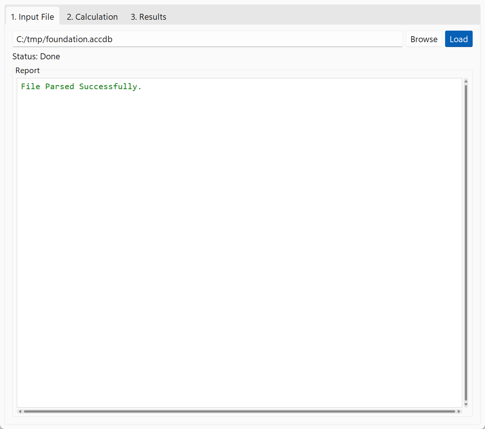
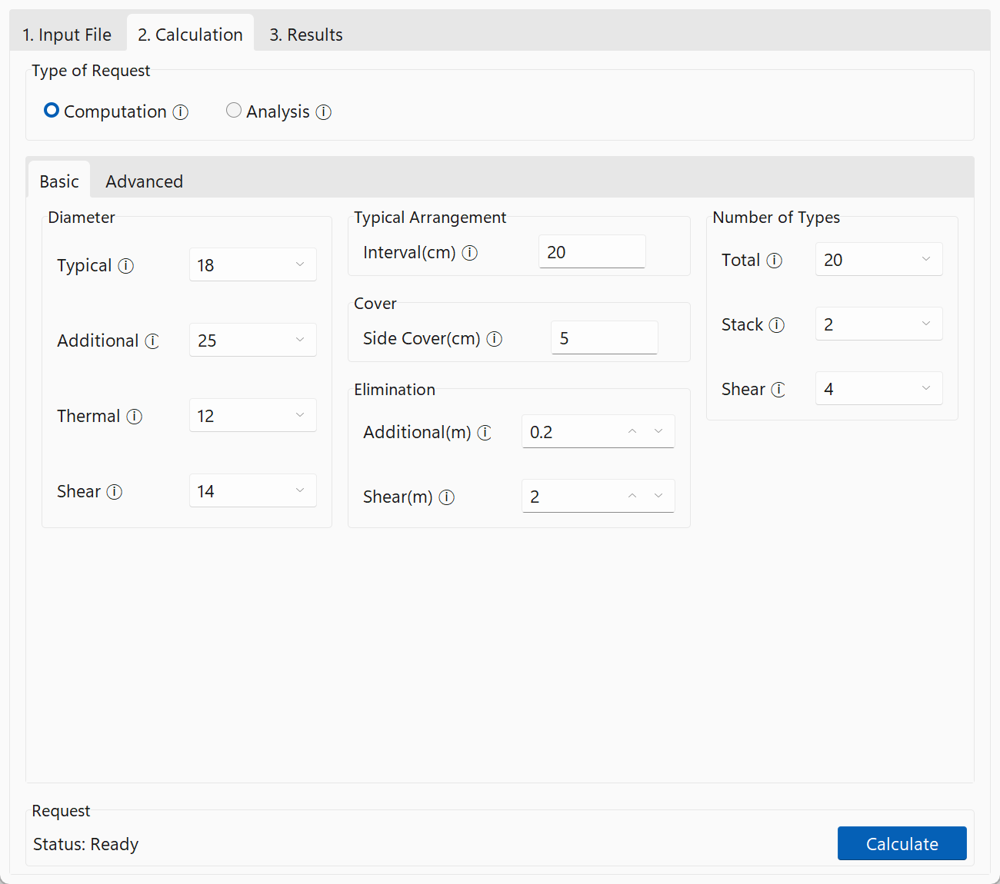
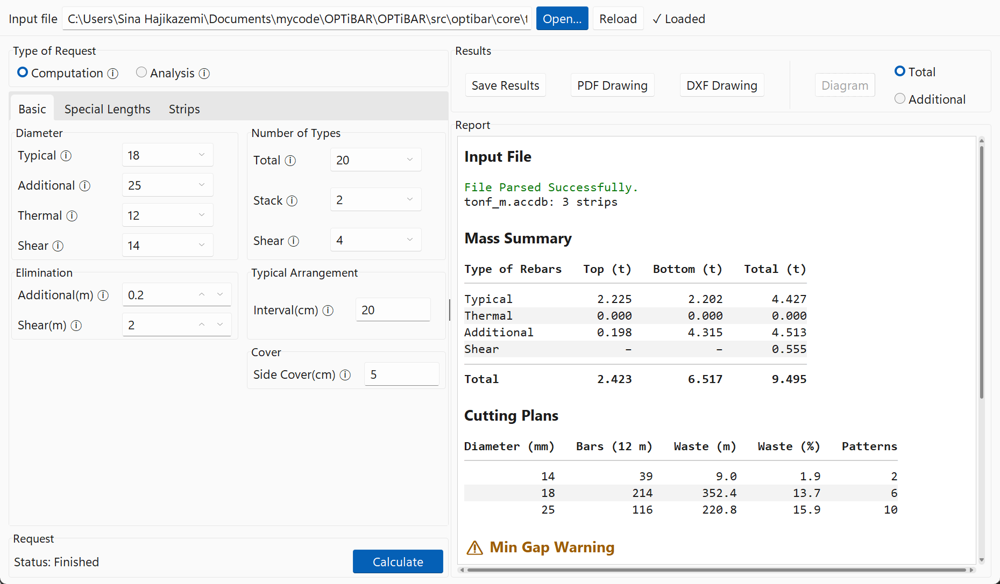
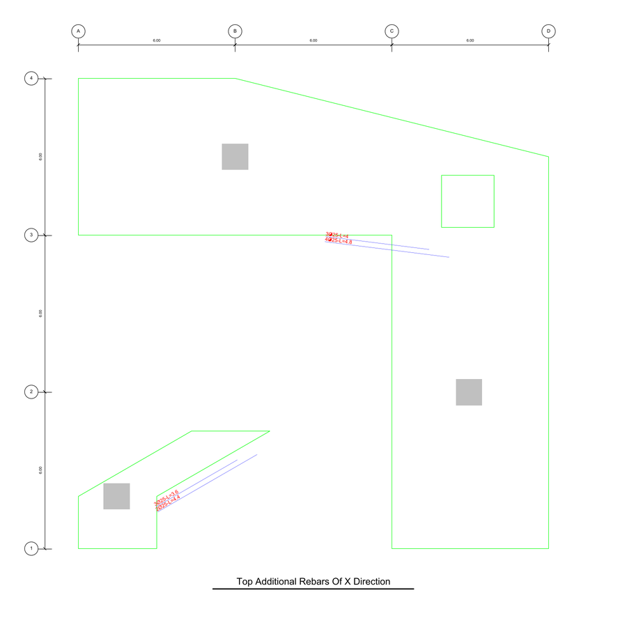

Your first detailing map
========================

In this tutorial, we turn a SAFE model into a rebar detailing map.
We use a small sample foundation that comes with OPTiBAR and keep all the default settings, so you can see the whole way from the input file to the drawing in a few minutes.

Before you start, [install OPTiBAR](../how-to/install.md) from a clone of the repository.

## 1. Start OPTiBAR

From the folder of the repository, run:

```bash
uv run main.py
```

The OPTiBAR window opens with three tabs: **1. Input File**, **2. Calculation** and **3. Results**.
We go through them in this order.

## 2. Load the sample foundation

The sample is a mat foundation designed in SAFE 2016 and exported to Microsoft Access.
It is in the repository at `src/optibar/core/tests/parser/data_files/tonf_m.accdb`.

In **1. Input File**, press **Browse**, choose `tonf_m.accdb` and press **Load**.

The **Report** box says the file was parsed successfully.



## 3. Run the calculation

Open **2. Calculation**. The settings are already filled in with their defaults; leave them as they are.



Press **Calculate**.
The button turns into **Stop** and the status line says **Status: Running**.
After a few seconds it says **Status: Finished**, and the button says **Calculate** again.

## 4. Look at the results

Open **3. Results**.
The **Report** box starts with the **Mass Summary**: about 9.5 tons of rebars for the sample, of which 4.5 tons are additional rebars.
Below it are the **Cutting Plans**, with the number of 12 m stock bars of each diameter and the waste.



Scroll down: the report ends with two warnings.

* **Min Gap Warning**: in strip CSN4, the bottom bars are closer than 2.5 cm.
* **Ratio Warning**: in strips CSA1, CSB1 and CSN4, the typical rebars at a 20 cm interval are less than the minimum steel ratio of 0.0018.

Warnings don't stop the detailing; they point to strips the designer should check.
In a real project, you would fix them, for example by setting more typical bars for those strips.
[Detailing rules](../reference/detailing-rules.md#typical-rebars) lists all the checks.

The **Total** setting allowed 20 different lengths of additional rebars, but this foundation needs only 9.

## 5. Save the drawing

Press **DXF Drawing** and save the file as `sample.dxf`.
Open it in any CAD program, for example AutoCAD, BricsCAD or a free DXF viewer.

You see a row of sheets with the foundation plan.
The first sheet names the strips; the next ones show the typical and additional rebars, top and bottom, in X and Y; then come the shear zones.
Zoom into a sheet of additional rebars: every bar is labelled with its number, diameter and length, for example `4Ø25-L=4.8`.



To the right of the sheets are the tables with the piece lists and the mass summary, and below them the cutting plans.

## What you did

You loaded a SAFE model, detailed it with the default settings, and saved the detailing map.

Next:

* Detail your own foundation: [export the model from SAFE](../how-to/export-from-safe.md).
* Change the settings: [Settings](../reference/settings.md) lists all of them.
* Learn why OPTiBAR limits the number of bar lengths: [Basic Concepts](../explanation/intro.md).
